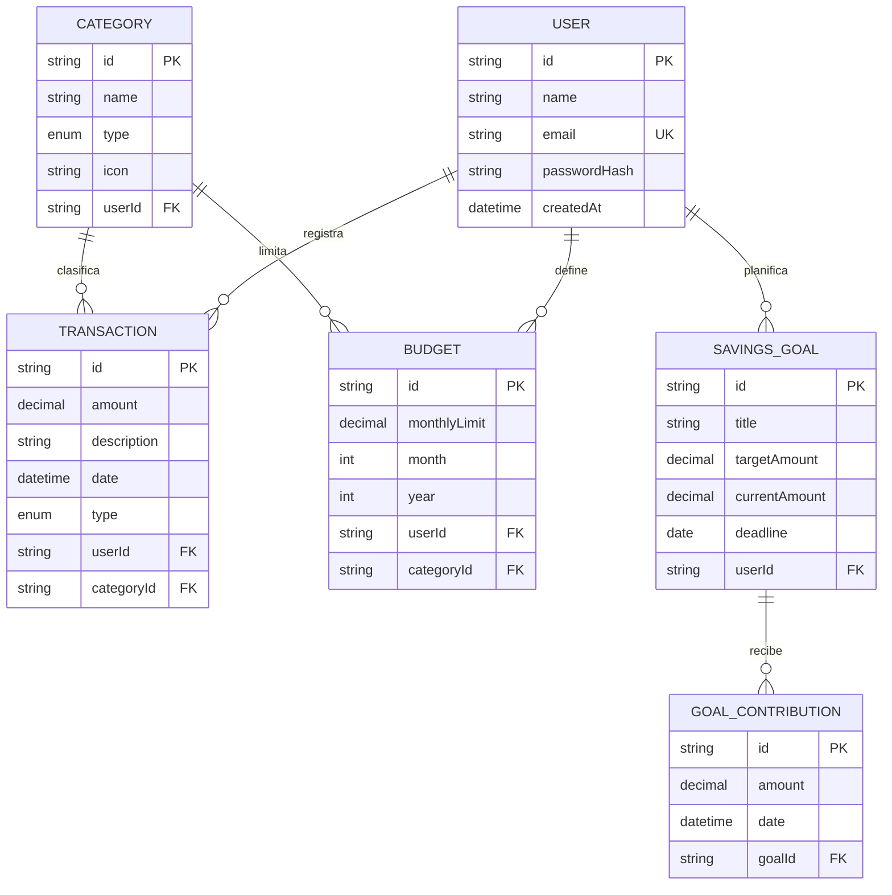

# Modelo de datos

El modelo propuesto mantiene cada registro asociado a un usuario. Los identificadores son `UUID` o `cuid`; las cantidades se almacenan como `DECIMAL`, nunca como punto flotante en la base de datos. La moneda de la aplicación es GTQ.

## Entidades

| Entidad | Campos principales | Relaciones y reglas |
|---|---|---|
| User | id, name, email, passwordHash, createdAt | Email único; un usuario tiene muchas transacciones, presupuestos y metas. |
| Category | id, name, type, icon, userId nullable | `type` es INCOME o EXPENSE; categorías predefinidas y opcionalmente propias. |
| Transaction | id, amount, description, date, type, userId, categoryId | Pertenece a un usuario y categoría; amount > 0; tipo consistente con la categoría. |
| Budget | id, monthlyLimit, month, year, userId, categoryId | Límite positivo; combinación usuario/categoría/mes/año única. |
| SavingsGoal | id, title, targetAmount, currentAmount, deadline, userId | Meta de un usuario; monto objetivo positivo. |
| GoalContribution | id, amount, date, note, goalId | Aporte positivo vinculado a una meta; permite conservar el historial de aportaciones. |

## Diagrama entidad-relación

El `schema.prisma` actual es un punto de partida y todavía no contiene `Category`, `Budget` ni `GoalContribution`; el esquema deberá evolucionar con migraciones antes de implementar esos requerimientos.
