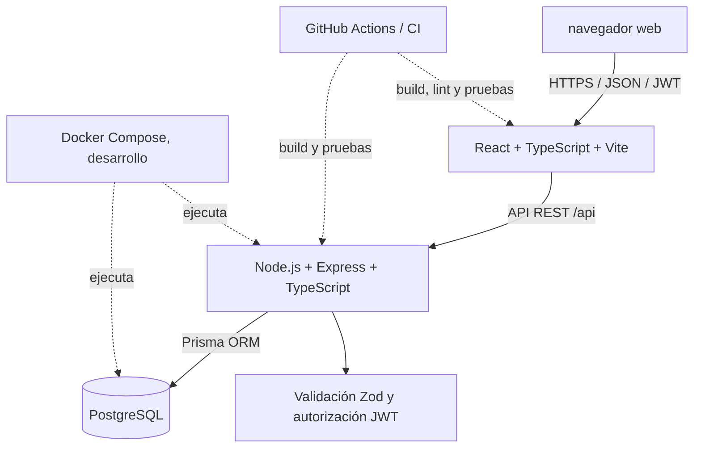

# Arquitectura propuesta

## Decisión

Se usará React + TypeScript + Vite, Node.js + Express + TypeScript, PostgreSQL y Prisma. Esta selección sigue la tecnología que la consigna pide explícitamente en la sección de aplicación y la rúbrica de evaluación. El PDF recibido propone Java/Spring Boot y SQL Server; esa propuesta se registra como una inconsistencia y no será la arquitectura de este repositorio.

## Diagrama

## Responsabilidades

- **Frontend:** rutas, formularios, accesibilidad, validación inmediata y presentación de datos; consume la API y no conecta directamente a PostgreSQL.
- **API:** autenticación, autorización, validación del cuerpo, reglas de negocio y respuestas JSON. Cada consulta de datos privados filtra por el usuario autenticado.
- **Persistencia:** PostgreSQL guarda usuarios, categorías, transacciones, presupuestos y metas; Prisma mantiene el esquema y las migraciones.
- **Configuración:** secretos y URLs se leen de variables de entorno; `.env` local no se versiona.
- **Entrega:** Docker facilita el desarrollo; CI ejecutará revisiones y pruebas. El despliegue cloud y CI/CD todavía están pendientes.

## Rutas REST iniciales

| Método y ruta | Uso |
|---|---|
| POST `/api/auth/register` | Crear cuenta |
| POST `/api/auth/login` | Iniciar sesión y emitir JWT |
| GET/POST `/api/transactions` | Listar y crear movimientos |
| GET/PATCH/DELETE `/api/transactions/:id` | Consultar, editar y eliminar movimiento propio |
| GET/POST `/api/budgets` | Consultar y crear presupuestos |
| GET/POST `/api/goals` | Consultar y crear metas |
| POST `/api/goals/:id/contributions` | Registrar aportación a una meta |

Las rutas de autenticación, transacciones y metas indicadas están implementadas en la API. Las aportaciones usan una transacción de base de datos y se asocian al usuario propietario. Las rutas de presupuestos y la interfaz para editar/eliminar movimientos siguen pendientes; la API no sustituye las pruebas ni el despliegue.
