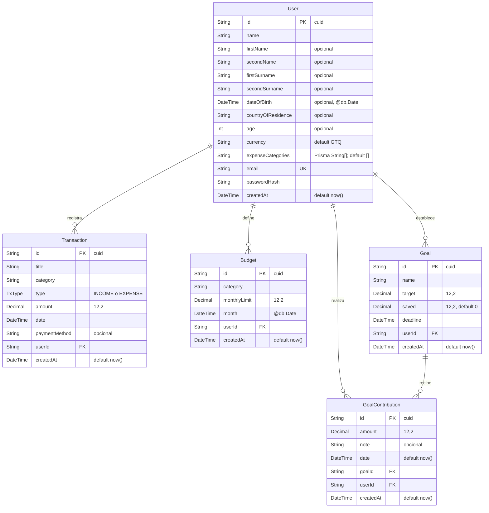

# Diagrama entidad-relación de KUDO 2.0

Fuente: [backend/prisma/schema.prisma](https://github.com/4paula0r/kudo-app/blob/prepare-kudo-proyecto1/backend/prisma/schema.prisma), consultado en la rama `prepare-kudo-proyecto1` el 3 de noviembre de 2026. El diagrama representa exclusivamente los cinco modelos y el enum definidos allí.

## Relaciones, cardinalidades y restricciones

- Un `User` puede tener cero o muchos `Transaction`, `Budget`, `Goal` y `GoalContribution`; cada registro hijo pertenece a un único usuario mediante su FK `userId`.
- Un `Goal` puede tener cero o muchos `GoalContribution`; cada aporte apunta a una sola meta mediante `goalId` y a un solo usuario mediante `userId`.
- `User.email` es único. `Budget` tiene restricción compuesta única sobre `[userId, category, month]`.
- Las cinco claves primarias son `id`, de tipo `String` y con `@default(cuid())`.
- Las relaciones de transacciones, presupuestos, metas y aportes con `User` declaran `onDelete: Cascade). La relación de `GoalContribution` con `Goal` también declara `onDelete: Cascade`.
- Índices declarados: `Transaction([userId, date])`, `Goal([userId, createdAt])`, `GoalContribution([goalId, date])`, `GoalContribution([userId, date])` y `Budget([userId, month])`.
- `TxType` es un enum, no una entidad: sus valores son `INCOME` y `EXPENSE`.
